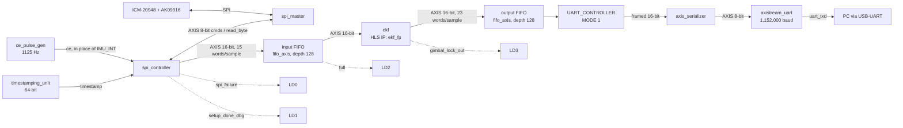

# FPGA: IMU Acquisition and Hardware EKF

FPGA design for the project. It reads an ICM-20948 (6-axis IMU plus AK09916
magnetometer) over SPI at 1125 Hz, timestamps each sample, runs the Extended
Kalman Filter in hardware (an HLS-generated IP core), and streams the raw sample
together with the filter state to a PC over UART.

Target device: Digilent Basys 3 (`xc7a35tcpg236-1`) | VHDL-2008 | Vivado 2026.1

---

## Folder Structure

```
FPGA/
├── IP_repo/            Custom Vivado IP cores, packaged and ready to import
├── hls/                HLS C++ source and testbenches of the EKF (see hls/README.md)
├── block_designs/      Block design Tcl exports
│   ├── IMU_ekf.tcl         Full design: acquisition + hardware EKF (built by default)
│   └── IMU_Streaming.tcl   Acquisition only, raw MODE_0 stream (earlier design)
├── Constrain_files/    XDC constraints
│   ├── streaming.xdc       Active pin and clock constraints
│   └── Basys-3-Master.xdc  Digilent master template (reference only, not added)
└── scripts/
    └── create_project.tcl  Recreates the Vivado project
```

The Vivado project itself is generated in `build/`, one level above the
repository root, and is not tracked.

---

## Recreating the Project

**Prerequisites:** Vivado 2026.1.

1. Open Vivado's Tcl Console (Window → Tcl Console).
2. Source the recreation script:
   ```tcl
   source /path/to/repo/FPGA/scripts/create_project.tcl
   ```
3. The script:
   - creates the project `imu_ekf` at `build/imu_ekf`, one level above the
     repository root, for part `xc7a35tcpg236-1`
   - adds `FPGA/IP_repo` as a custom IP repository and updates the catalog
   - adds `streaming.xdc` as the target constraints file
   - recreates the block design from `IMU_ekf.tcl`, validates it, and creates the
     HDL wrapper
   - generates the IP output products
4. Open `build/imu_ekf/imu_ekf.xpr` and run Synthesis, Implementation and
   Generate Bitstream as usual.

The script resolves all paths relative to its own location, so it can be sourced
from any working directory.

To build the acquisition-only design instead, change the `source` line in
`create_project.tcl` to `IMU_Streaming.tcl`. Both block-design scripts create a
design named `IMU_Streaming`.

---

## Architecture (`IMU_ekf.tcl`)



All blocks run on the 100 MHz board clock (`clk_in`). `ext_reset_in` (center
button) goes through `reset_synchronizer` to every block's active-low reset.

Per sample:

1. `ce_pulse_gen` triggers a sample every 1/1125 s.
2. `spi_controller` latches the 64-bit timestamp from `timestamping_unit` and
   drives `spi_master` through one burst SPI read of accel, gyro, temperature and
   magnetometer. At reset it runs a table-driven setup sequence on the ICM-20948
   and AK09916 first.
3. It packs the sample into a 15-word AXI-Stream burst into the input FIFO.
4. The `ekf` IP converts and filters the sample and writes a 23-word result
   frame: raw IMU words, `dt` and the state `[phi, theta, psi, bx, by, bz]`. See
   [`hls/README.md`](hls/README.md).
5. `UART_CONTROLLER` (configured for **MODE 1**) wraps the frame in
   SYNC / MODE-LEN / PAYLOAD / CHK, `axis_serializer` splits the 16-bit words into
   bytes, and `axistream_uart` sends them to the PC.

The frame format is documented in
[`IP_repo/UART_CONTROLLER/readme.md`](IP_repo/UART_CONTROLLER/readme.md). It is
decoded on the PC by [`host/imu_pipeline`](../host/imu_pipeline).

---

## Pin Assignments (`streaming.xdc`)

| Signal | Basys 3 pin | Board resource |
|---|---|---|
| `clk_in` | W5 | 100 MHz oscillator |
| `ext_reset_in` | U18 | Center button (BTNC) |
| `spi_cs_n`, `spi_mosi`, `spi_miso`, `spi_sclk` | K17, M18, N17, P18 | Pmod JC1–JC4 |
| `IMU_INT` | L17 | Pmod JC7 (constrained, not used yet, see Known Limitations) |
| `uart_rxd`, `uart_txd` | B18, A18 | USB-UART bridge |
| `spi_failure` | U16 | LD0 |
| `setup_done_dbg` | E19 | LD1 |
| `fifo_full` | U19 | LD2 (input FIFO full) |
| `gimbal_lock_out_0` | V19 | LD3 (EKF pitch within 1° of ±90°) |

---

## IP Cores

| IP folder | Block name | Function |
|---|---|---|
| [`SPI_MASTER`](IP_repo/SPI_MASTER/readme.md) | `spi_master` | SPI master, byte-level AXI-Stream interface |
| [`SPI_CONTROLLER`](IP_repo/SPI_CONTROLLER/readme.md) | `spi_controller` | ICM-20948 / AK09916 setup sequence and per-sample burst read |
| `timestamping_unit` | `timestamping_unit` | Free-running 64-bit timestamp counter |
| [`CLOCK_EN`](IP_repo/CLOCK_EN/readme.md) | `ce_pulse_gen` | Clock-enable pulse generator (sample rate) |
| `FIFO_AXIS` | `fifo_axis` | AXI-Stream FIFO (used as input and output buffer) |
| `ekf` | `ekf` | HLS-generated EKF (source in [`hls/`](hls)) |
| [`UART_CONTROLLER`](IP_repo/UART_CONTROLLER/readme.md) | `UART_CONTROLLER_v1_0` | Frames samples (MODE 0: raw IMU, MODE 1: IMU + EKF state) |
| [`axis_serializer`](IP_repo/axis_serializer/readme.md) | `axis_serializer` | 16-bit to 8-bit AXI-Stream width conversion |
| [`AXI_STREAM_UART`](IP_repo/AXI_STREAM_UART/readme.md) | `axistream_uart` | AXI-Stream UART transmitter/receiver |
| `RESET_SYNC` | `reset_synchronizer` | Synchronizes the external reset to the clock |

Every IP is already packaged (`component.xml` plus `xgui/`). Vivado picks it up
as soon as `IP_repo` is added to the IP repository paths, which
`create_project.tcl` does. The hand-written IPs use this layout, where each part
exists:

```
IP_repo/<IP_NAME>/
├── src/            VHDL source
├── tb/             Testbench
├── sim/            GHDL makefile and GTKWave layout, or a Vivado .wcfg
├── doc/            Product guide (PDF)
├── xgui/           Vivado IP packager GUI file
├── component.xml   IP-XACT descriptor
└── readme.md       Interface, internals, known limitations, verification
```

`ekf` is the exported Vivado IP from Vitis HLS (`hdl/`, `constraints/`, `doc/`,
`xgui/`, `component.xml`). To regenerate it, see
[`hls/README.md`](hls/README.md).

---

## Simulation

IPs with a GHDL makefile (`CLOCK_EN`, `SPI_CONTROLLER`, `UART_CONTROLLER`,
`timestamping_unit`) are simulated from their `sim/` folder:

```bash
cd FPGA/IP_repo/UART_CONTROLLER/sim
make          # analyze, elaborate and run the testbench
make wave     # same, then open the waveform in GTKWave
```

This needs GHDL and GTKWave (see `requirements.txt` in the repository root).
`SPI_MASTER` and `AXI_STREAM_UART` are simulated in Vivado with the `.wcfg`
waveform configurations in their folders. The HLS testbenches are described in
[`hls/README.md`](hls/README.md).

---

## Known Limitations

- **The ICM-20948 interrupt pin is not used yet.** `IMU_INT` is constrained to
  Pmod JC7, but in the block design `ce_pulse_gen`'s pulse drives
  `spi_controller`'s `IMU_INT` input instead. This keeps the sample rate
  deterministic for testing. Switching to the real interrupt pin is planned.
- **Downstream backpressure is assumed to stay under one SPI byte period.** If
  `m_axis_fifo_tready` in `spi_controller` is held low longer than that, SPI byte
  tracking desyncs. This has not happened in current testing.
- **The magnetometer ST2 status byte doesn't fully match the AK09916 datasheet.**
  In observed captures its upper bits step through a repeating pattern instead of
  staying fixed. Accel, gyro, temperature and magnetic field readings are not
  affected. Fresh magnetometer samples are detected by comparing consecutive
  readings instead (both in the EKF IP and on the host).
