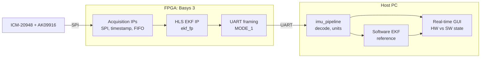
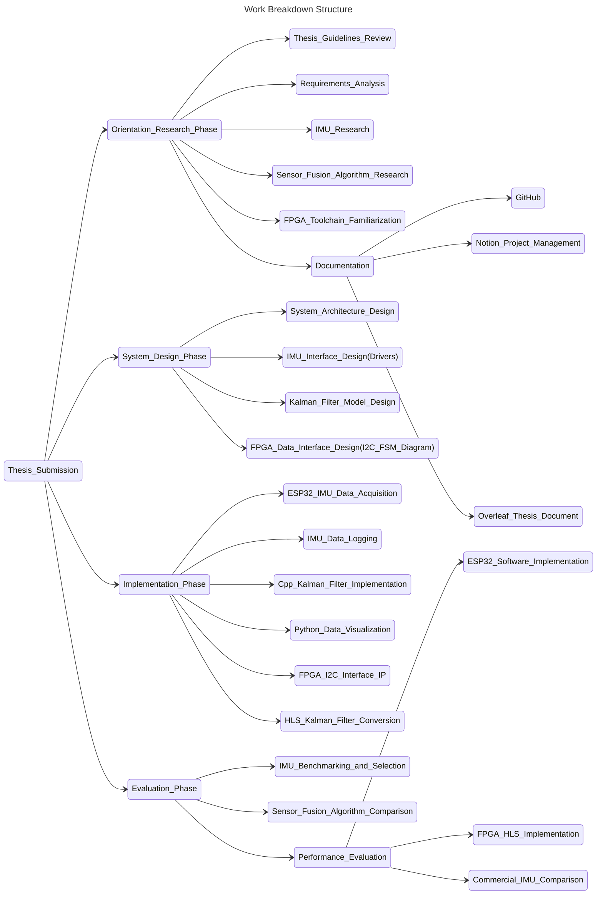

# IMU Kalman Filter on FPGA using High-Level Synthesis

Bachelor thesis project on implementing IMU sensor fusion with an Extended Kalman
Filter (EKF) on an FPGA, using High-Level Synthesis (HLS). The project covers the
full pipeline: benchmarking candidate IMUs by Allan variance, characterizing
sensor noise, acquiring sensor data on real hardware, designing and validating
the filter in software, and running it on FPGA fabric.

Supervisor: Prof. Lutz Leutelt

---

## System Overview



The FPGA reads the ICM-20948 at 1125 Hz, runs the EKF in hardware, and streams
each sample with the filter state to the PC. The host decodes the stream, runs
the same filter in software as a reference, and shows both side by side.

---

## Repository Structure

```
├── FPGA/              Vivado design: custom IP cores, HLS EKF, block designs, constraints
│   ├── IP_repo/       Packaged IP cores (SPI, UART, FIFO, timestamping, ekf, ...)
│   ├── hls/           HLS C++ source and testbenches of the EKF
│   ├── block_designs/ Block design Tcl exports
│   ├── Constrain_files/  XDC constraints
│   └── scripts/       Vivado project recreation script
├── host/              PC software: UART decode, software EKF, GUI, calibration tools
├── firmware/          ESP32 firmware for the IMU benchmarking phase
├── docs/              Datasheets, literature, EKF design notebook, thesis source
├── params/            Filter parameter file (planned single source of constants)
└── requirements.txt   Python dependencies, plus GHDL/GTKWave notes
```

Each part has its own README with the details:

| Folder | README |
|---|---|
| FPGA design | [`FPGA/README.md`](FPGA/README.md) |
| HLS EKF | [`FPGA/hls/README.md`](FPGA/hls/README.md) |
| Host software | [`host/README.md`](host/README.md) |
| Real-time GUI | [`host/gui/README.md`](host/gui/README.md) |
| ESP32 firmware | [`firmware/README.md`](firmware/README.md) |

---

## Getting Started

### Host software (Python)

```bash
git clone --recurse-submodules https://github.com/Shiro-01/IMU-Kalman-filter-on-an-FPGA-with-High-level-Synthesis.git
cd IMU-Kalman-filter-on-an-FPGA-with-High-level-Synthesis
python3 -m venv .venv
source .venv/bin/activate
pip install -r requirements.txt
```

Try the GUI without hardware (select the **Mock** source and click **Start**):

```bash
python3 host/gui/gui_app.py
```

### FPGA

In Vivado's Tcl console:

```tcl
source /path/to/repo/FPGA/scripts/create_project.tcl
```

This recreates the project with the custom IP repository, constraints and the
EKF block design. The project is created in `build/`, one level above the
repository. See [`FPGA/README.md`](FPGA/README.md) for tool versions and details.

### IP testbenches (VHDL)

Install [GHDL](https://github.com/ghdl/ghdl) and
[GTKWave](https://gtkwave.sourceforge.net) (see `requirements.txt`), then from an
IP's `sim/` folder:

```bash
make
```

`make wave` also opens the waveform in GTKWave.

### ESP32 firmware

Open a sketch in `firmware/esp32/` with the Arduino IDE (Arduino-ESP32 core 3.x).
See [`firmware/README.md`](firmware/README.md).

---

## Project Phases

### 1. IMU benchmarking

Three candidate IMUs (MPU6050, ICM-20948, WitMotion WT901) were logged
simultaneously at 1 kHz by an ESP32
([`firmware/esp32/imu_benchmark_logger`](firmware/esp32/imu_benchmark_logger))
and compared by Allan deviation (ARW, bias instability, rate random walk) in a
Streamlit dashboard
([`host/esp32_benchmark`](host/esp32_benchmark)). The ICM-20948 was selected.

### 2. FPGA acquisition pipeline

Custom VHDL IP cores read the ICM-20948 and its AK09916 magnetometer over SPI at
1125 Hz, timestamp each sample, and stream framed, checksummed packets to the PC
over UART. The host side ([`host/imu_pipeline`](host/imu_pipeline)) resyncs on
the frames, validates them and converts raw counts to physical units.

### 3. Sensor characterization and EKF design

The selected sensor's noise was measured by Allan variance and its magnetometer
calibrated (hard/soft-iron), using the loggers and tools in
[`host/calibration`](host/calibration). The EKF (state: roll, pitch, yaw and
gyro bias) is derived in
[`docs/Literature/KalmanFilter/Kalman_Filter_for_IMU_Explained_v1.ipynb`](docs/Literature/KalmanFilter/Kalman_Filter_for_IMU_Explained_v1.ipynb).
The software reference implementation is
[`host/imu_pipeline/ekf.py`](host/imu_pipeline/ekf.py).

### 4. EKF in hardware with HLS

The filter was written in C++ for Vitis HLS ([`FPGA/hls`](FPGA/hls)), exported as
the `ekf` IP core and integrated into the block design between the acquisition
FIFO and the UART output. The FPGA now streams **MODE_1** frames (raw IMU data,
`dt` and the hardware filter state). The host runs the software EKF on the same
samples, so the two can be compared directly, live in the GUI or on the console
with `host/imu_pipeline/app_mode1.py`.

---

## Where Things Stand

| Area | Status |
|---|---|
| IMU benchmarking | Done |
| FPGA acquisition pipeline | Done |
| Noise characterization and magnetometer calibration | Done |
| EKF design and Python reference | Done |
| HLS EKF (float), exported as IP and integrated in the block design | Done |
| Host decode, software reference EKF, real-time HW vs SW GUI | Done |
| Evaluation (HW vs SW accuracy, resources and timing, commercial IMU comparison) | In progress |

---

## WBS



---

## Tools

| Tool | Used for |
|---|---|
| AMD Vivado / Vitis HLS | FPGA design and HLS synthesis (versions in [`FPGA/README.md`](FPGA/README.md)) |
| GHDL, GTKWave | VHDL IP testbenches |
| Python 3 | Host software and analysis tools (`requirements.txt`) |
| Arduino IDE + Arduino-ESP32 core 3.x | ESP32 firmware |
